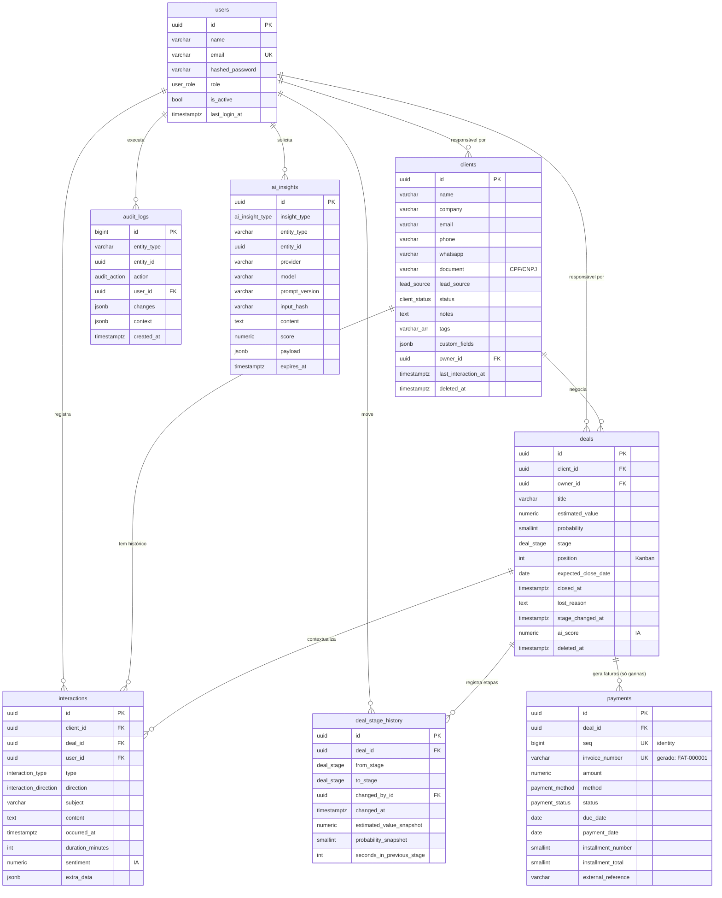

# Modelagem do banco de dados

PostgreSQL 16 · SQLAlchemy 2.0 (async) · Alembic · chaves primárias UUID (exceto `audit_logs`, BIGINT identity)

## Diagrama entidade-relacionamento

## Regras de integridade no banco

| Tabela | Regra | Como |
|---|---|---|
| users | e-mail único | `UNIQUE(email)` — gravado em minúsculas pelo schema |
| clients | CPF/CNPJ único entre ativos | índice único parcial `WHERE deleted_at IS NULL` |
| deals | valor ≥ 0, probabilidade 0–100, ai_score 0–100 | `CHECK` |
| deals | `closed_at` preenchido ⇔ etapa fechada | `CHECK closed_at_consistency` |
| deals → clients | não apaga cliente com negociações | `ON DELETE RESTRICT` |
| payments | valor > 0; pago exige data; parcela ≤ total | `CHECK` |
| payments | número da fatura sequencial sem colisão | `IDENTITY` + coluna gerada (`GENERATED ALWAYS AS`) |
| payments → deals | não apaga negociação com faturas | `ON DELETE RESTRICT` |
| interactions | sentimento entre -1 e 1; duração ≥ 0 | `CHECK` |
| interactions / stage_history | apagados junto com o pai | `ON DELETE CASCADE` |

Regras que dependem de outras tabelas ficam na camada de serviço (Etapa 2):
pagamento só em negociação **Fechado Ganho**; motivo obrigatório ao perder;
toda mudança de etapa grava `deal_stage_history` e `audit_logs`.

## Índices estratégicos

| Índice | Consulta atendida |
|---|---|
| `ix_clients_name_trgm`, `ix_clients_company_trgm` (GIN pg_trgm) | busca "contém" por nome/empresa |
| `ix_clients_status_owner` | lista filtrada por status e vendedor |
| `ix_clients_tags` (GIN) | filtro por tag |
| `ix_deals_board` (parcial, sem excluídos) | montagem do Kanban: etapa + posição |
| `ix_deals_closed_at` (parcial) | conversão e ticket médio por período |
| `ix_interactions_client_occurred` | timeline do cliente |
| `ix_payments_status_due_date` | contas a receber e inadimplência |
| `ix_payments_paid_date` (parcial `status='pago'`) | receita realizada por período |
| `ix_deal_stage_history_*` | tempo médio por etapa, funil histórico |
| `ix_audit_logs_entity` | histórico de alterações de um registro |
| `ix_ai_insights_lookup`, `ix_ai_insights_input_hash` | cache e último insight por entidade |

## Por que essa modelagem favorece IA

- **Nada se perde:** soft delete em clientes e negociações; `audit_logs` guarda o diff de cada alteração.
- **Dataset rotulado de graça:** `deal_stage_history` + resultado final (ganho/perdido) = exemplos de treino para lead scoring, com snapshots de valor e probabilidade em cada etapa.
- **Features prontas:** `last_interaction_at`, `stage_changed_at`, `seconds_in_previous_stage`, `custom_fields` (JSONB).
- **Texto para LLM:** `interactions.content` é a fonte do resumo do cliente; `sentiment` recebe a saída da IA.
- **Rastreabilidade:** `ai_insights` registra provedor, modelo, versão do prompt, tokens e latência — permite comparar o score previsto com o resultado real.
